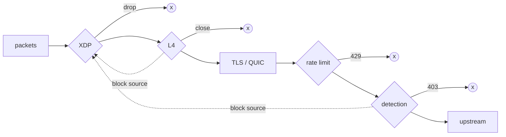

<p align="center">
  
</p>

<h1 align="center">dvarapala</h1>

<p align="center">
  <b>A guardian at the gate.</b> An anti-DDoS gateway in Rust, with protection from L4 to L7.
</p>

<p align="center">
  <a href="https://github.com/franzramadhan/dvarapala/actions/workflows/ci.yml"></a>
  <a href="https://github.com/franzramadhan/dvarapala/actions/workflows/coverage.yml"></a>
  <a href="https://github.com/franzramadhan/dvarapala/actions/workflows/coverage.yml"></a>
  <a href="https://github.com/franzramadhan/dvarapala/releases/latest"></a>
  <a href="LICENSE"></a>
</p>

<p align="center">
  <a href="https://dvarapala.franzramadhan.dev"><b>Docs</b></a> ·
  <a href="#install">Install</a> ·
  <a href="CONFIG.md">Configuration</a> ·
  <a href="examples/README.md">Examples</a> ·
  <a href="ROADMAP.md">Roadmap</a> ·
  <a href="CHANGELOG.md">Changelog</a>
</p>

dvarapala sits in front of your app, bounds each client's connections and
requests, learns what normal traffic looks like, and drops floods before
they reach the upstream. It is named after the Dvarapala, the guardian
statues at Javanese temple gates.

## Three ways to run it

| Mode | What it does | Start with |
|---|---|---|
| **Reverse proxy** | Protects your app from inbound floods: HTTP/1.1, HTTP/2, gRPC, WebSocket, optional HTTP/3 | [`dvarapala.toml`](examples/dvarapala.toml) |
| **Forward proxy** | Holds your outbound calls to each third-party API's agreed rate and concurrency | [`forward-proxy.toml`](examples/forward-proxy.toml) |
| **In process** | The same limits inside a Go, Python or JavaScript service, over a C ABI | [`sdk/`](sdk/README.md) |

Either proxy mode scales out: replicas behind one load balancer share their
limits through Redis or PostgreSQL ([`cluster.toml`](examples/cluster.toml)).

## What it protects

Every layer is optional and configurable, and every verdict is a Prometheus
metric and a structured log line, so you can watch before you enforce.

| Layer | Protection | |
|---|---|---|
| **XDP** | Block list, per-source packet, SYN and UDP rates in the NIC driver; dynamic blocks fed by L4 and L7. Linux, feature `xdp` | [RFC 0011](rfc/0011-xdp.md) |
| **L4** | Connections per client and in total, accept rate, header, idle and slow-body timeouts, before any TLS or HTTP | [RFC 0009](rfc/0009-l4-limits.md) |
| **TLS** | rustls with ALPN, `SIGHUP` certificate reload, bounded handshakes, verified `https://` upstreams | [RFC 0003](rfc/0003-tls.md) |
| **QUIC** | HTTP/3 listener with Retry under load, connection and stream limits, no 0-RTT. Feature `http3` | [RFC 0006](rfc/0006-http3.md) |
| **HTTP/2** | Rapid reset, header list and keepalive limits; trailers and gRPC-shaped local errors | [RFC 0004](rfc/0004-http2-grpc.md) |
| **L7** | Token bucket per client with a bounded table; `X-Forwarded-For` only from trusted proxies | [RFC 0001](rfc/0001-foundation.md) |
| **Detection** | Heavy hitters, rate baseline, source entropy, optional XGBoost model; `observe` first, then `enforce` | [RFC 0002](rfc/0002-adaptive-detection.md) |
| **WebSocket** | Upgrades rate limited like any request; tunnel count, idle and lifetime limits | [RFC 0005](rfc/0005-websocket.md) |
| **Egress** | Per-destination rate, concurrency and bounded queue; provider `Retry-After` pauses; `CONNECT` tunnels | [RFC 0007](rfc/0007-forward-proxy.md) |
| **Embedding** | Rate limit, detection and connection limits for Go, Python and JavaScript, with HTTP middleware | [RFC 0008](rfc/0008-sdk.md) |
| **Cluster** | One per-client limit, egress budget and heavy hitter list across replicas, synced off the request path. Features `redis`, `postgres` | [RFC 0010](rfc/0010-shared-state.md) |

## Install

Static binaries for Linux (musl) and macOS, `x86_64` and `aarch64`:

```sh
brew install franzramadhan/tap/dvarapala
```

or

```sh
curl -fsSL https://dvarapala.franzramadhan.dev/install.sh | sh
```

The script checks the download against the release's `SHA256SUMS` and
installs to `/usr/local/bin` (when writable) or `~/.local/bin`.
`DVARAPALA_VERSION=v<version>` pins a release, `DVARAPALA_INSTALL=<dir>`
picks the directory. Tarballs are also on the
[releases](https://github.com/franzramadhan/dvarapala/releases) page.

Container image (`linux/amd64`, `linux/arm64`), `FROM scratch` with the
static binary, running as UID 10001 on port 8080:

```sh
docker run --rm -p 8080:8080 \
  -e DVARAPALA__UPSTREAM=http://app.example:8081 \
  ghcr.io/franzramadhan/dvarapala:<version>
```

Pass a config with `-v ./dvarapala.toml:/etc/dvarapala.toml:ro` and
`serve --config /etc/dvarapala.toml`, or set every key as an environment
variable. Set `DVARAPALA__METRICS__LISTEN=0.0.0.0:9090` to scrape metrics
from outside the container. The image has no CA bundle: for an `https://`
upstream, mount one and set `upstream_tls.ca_file`.

<details>
<summary><b>Build from source</b></summary>

The toolchain is pinned in `rust-toolchain.toml`. Optional protections are
cargo features, off by default:

```sh
cargo build --release                            # reverse and forward proxy, TLS
cargo build --release --features http3           # + HTTP/3 over QUIC
cargo build --release --features ml              # + the XGBoost scorer
cargo build --release --features redis,postgres  # + shared state backends
cargo build --release --features xdp             # + the XDP fast path (Linux)
```

</details>

## Quick start

The smallest config:

```toml
listen = "0.0.0.0:8080"
upstream = "http://127.0.0.1:8081"
```

```sh
dvarapala serve --config dvarapala.toml
```

Everything else has a default: 20 requests per second per client (burst
40), detection in `observe` mode, metrics on `127.0.0.1:9090`. Environment
variables override the file (`DVARAPALA__RATE_LIMIT__RATE=5`).

- Every key and metric: [CONFIG.md](CONFIG.md)
- TLS, gRPC, WebSocket, HTTP/3, connection limits, forward proxy, clusters
  and XDP: [examples/](examples/README.md)

## How it works



Each stage is cheaper than the next, so expensive work only happens for
traffic that survived the cheap checks. In `enforce` mode, sources refused
by L4 or dropped by detection are blocked in the XDP program for a while.
Both completed a TCP handshake, so a spoofed address cannot get a victim
blocked.

One engine decides every verdict and does no I/O, so the binary and the
SDKs share the same logic.

<details>
<summary><b>Crates</b></summary>

| Crate | Role |
|---|---|
| `engine` | Verdicts, token buckets, detection sketches, egress schedule. No I/O, no async runtime |
| `l4` | Listener wrapper: connection limits and timeouts |
| `l7` | `tower` layers: rate limit, detection |
| `proxy` | Reverse and forward proxy, TLS, HTTP/2, HTTP/3, tunnels |
| `store` | Shared state backends: memory, Redis, PostgreSQL |
| `xdp` | XDP loader (`aya`) and the checked-in eBPF object |
| `xdp-common` | `no_std` packet parser and map layouts shared with the program |
| `xdp-ebpf` | The eBPF program, its own workspace on a pinned nightly |
| `ffi` | C ABI (`dvarapala.h`) for the SDKs |
| `node` | N-API addon for the JavaScript SDK |
| `dvarapala` | The binary: config, metrics, signals |

Built on `tokio`, `hyper`, `tower`, `rustls`, `quinn`, `h3`, `redis`,
`tokio-postgres` and `aya`. CI fails when the idle binary goes over a
10 MB RSS budget. Rust crates embed as a git dependency; they are not on
crates.io.

</details>

## Project

> [!NOTE]
> 0.x is alpha: config keys and metrics may change between minor versions.

| | |
|---|---|
| **Changes** | [CHANGELOG.md](CHANGELOG.md) |
| **Roadmap** | Every feature lands through an RFC: [ROADMAP.md](ROADMAP.md), [rfc/](rfc/) |
| **Contributing** | Contributor and agent rules: [CLAUDE.md](CLAUDE.md) |
| **Security** | Report vulnerabilities privately: [SECURITY.md](SECURITY.md) |
| **License** | [MIT](LICENSE) |
